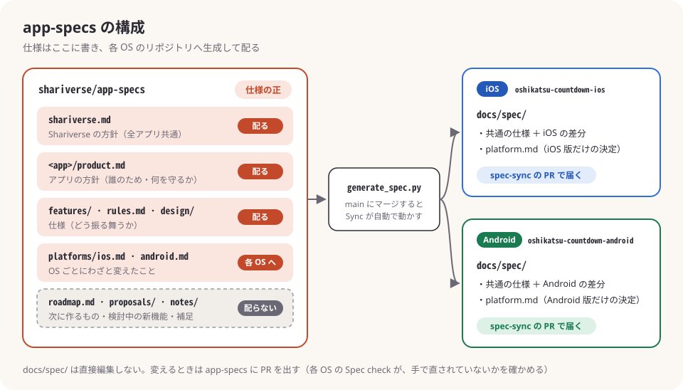
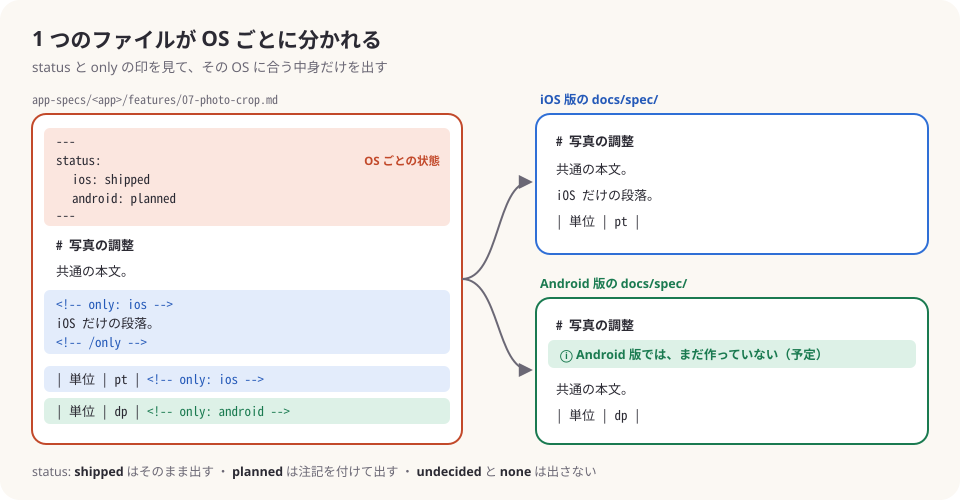
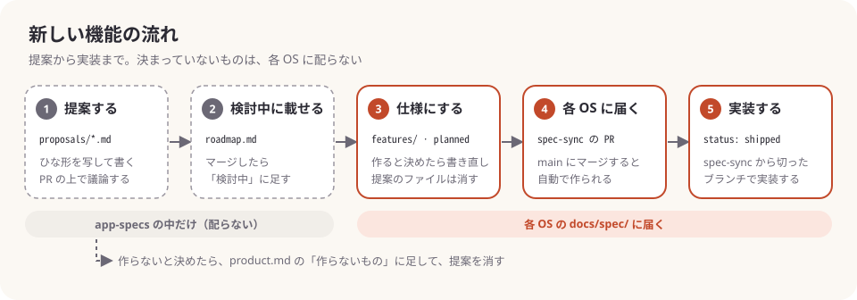

# app-specs

Shariverse のアプリの仕様を、OS に依らず 1 か所にまとめるリポジトリ。
ここが仕様の正で、各 OS のリポジトリの `docs/spec/` は、ここから生成したもの。



| アプリ | iOS | Android |
|---|---|---|
| [推し活カウントダウン](oshikatsu-countdown/README.md) | [oshikatsu-countdown-ios](https://github.com/shariverse/oshikatsu-countdown-ios) | [oshikatsu-countdown-android](https://github.com/shariverse/oshikatsu-countdown-android) |

## 置くもの・置かないもの

| 種類 | 答える問い | 置き場所 | 各 OS の `docs/spec/` に配る |
|---|---|---|---|
| Shariverse の方針（`shariverse.md`） | どのアプリにも効く決まりは | ここ | 配る |
| アプリの方針（`product.md`） | 誰のため・何を守る・何を作らない | ここ | 配る |
| ロードマップ（`roadmap.md`） | 次に何を作るか | ここ | 配らない |
| 提案（`proposals/`。1 ページの PRD） | この新機能はなぜ要るか・どこまでやるか | ここ | 配らない |
| 仕様（`features/` など） | どう振る舞うか | ここ | 配る |
| 補足（`notes/`） | 仕様に書くほどではない根拠・測った値・採らなかった案・実装の参考 | ここ | 配らない（仕様からのリンクは URL で残る） |
| 設計（`architecture.md`）・`CLAUDE.md` | どう作るか | 各 OS | — |
| ストアの掲載文・課金の商品の登録情報・ビルドとリリースの手順 | — | 各 OS | — |

ロードマップと提案を配らないのは、決まっていないもの・よく変わるものを、各 OS で実装の根拠として読ませないため。
補足を配らないのは、仕様を読む量を増やさないため。補足は実装の根拠にしない（食い違ったら仕様が正）。
両 OS でそろえる必要がある技術の決まり（ディープリンクの URL など）が出てきたときだけ、設計の話でもここの仕様に書く。

## 構成

```
apps.json                     アプリと、各 OS のリポジトリの対応
shariverse.md                 Shariverse の方針
<app>/
├── README.md                 概要・機能と対応状況・読む順番
├── product.md                方針
├── roadmap.md                ロードマップ（配らない）
├── proposals/<name>.md       検討中の新機能（配らない。決まったら消す）
├── notes/<topic>.md          補足（配らない。消さない）
├── rules.md                  画面をまたぐ規則
├── features/NN-<name>.md     機能ごとの仕様（NN は読む順番）
├── design/                   配色・書体・デザイントークン
└── platforms/
    ├── ios.md                iOS 版だけの決定
    └── android.md            Android 版だけの決定
scripts/generate_spec.py      各 OS の docs/spec/ を作る
templates/proposal.md         提案のひな形
templates/spec-check.yml      各 OS のリポジトリに置くワークフロー
docs/images/                  この README の図（SVG）
```

## 書き方



### OS の名前と API の名前

共通の文には `TabView`・`ModalBottomSheet` のような API の名前や、`pt`・`dp` だけの寸法を書かない。
OS の部品の名前が要るときは、下の `only` で囲むか、`platforms/` に書く。

### 対応状況（status）

機能ごとに、OS ごとの状態を先頭に書く。書かなければ、すべての OS で `shipped` として扱う。

```markdown
---
status:
  ios: shipped
  android: planned
---
# 写真の調整
```

| 値 | 意味 | その OS の `docs/spec/` |
|---|---|---|
| `shipped` | あり（その OS の既定のブランチに実装が入っている） | 出す |
| `planned` | 作る予定 | 「まだ作っていない（予定）」の注記を付けて出す |
| `undecided` | 作るか決めていない | 出さない（対応表に「未定」とだけ出る） |
| `none` | 作らない | 出さない（対応表に「作らない」とだけ出る） |

`shipped` にするのは、実装がその OS の既定のブランチに入ったとき（ストアに出したときではない）。ストアに出した版・出す予定の版は `roadmap.md` に書く。
`planned` のままにしておくと、その OS の `docs/spec/` に「まだ作っていない」と出続けるので、実装を入れたら忘れずに変える。

`features/` の状態から、`<app>/README.md` の「機能と対応状況」の表を作る。`status` を変えたら `write-index` で表を書き直す。

### OS ごとの違い

段落ごとに分けるときは、前後の行を `only` で囲む。

```markdown
<!-- only: android -->
全画面のダイアログ（M3）。日付は M3 の `DatePicker`。
<!-- /only -->
```

1 行だけのとき（表の行・箇条書き）は、行末に書く。

```markdown
| 通知の数 | iOS は 64 件まで | <!-- only: ios -->
```

- `only` の中に `only` は書けない
- 一時的に OS で違う（片方がまだ作っていない）だけなら `only` を使わず、`status` を `planned` にする

### リンク

- ファイルどうしは相対パスでつなぐ。生成するときに、各 OS の `docs/spec/` の中のパスに書き換える
- `platforms/ios.md` は、iOS 版では `platform.md` になる
- その OS に出さないファイル（`undecided`・`none`・ほかの OS の `platforms/`）へのリンクは、生成が止まる。リンクを `only` で囲む
- 配るファイルから `roadmap.md`・`proposals/` へはリンクしない（配った先でリンクが切れるため）
- `notes/` へのリンクは、生成のときにこのリポジトリの GitHub の URL（main を指す）になる（各 OS からも補足を辿れる）
- `shariverse.md` へのリンクは、各 OS の `docs/spec/shariverse.md` になる。`shariverse.md` の中には相対リンクを書かない
- アプリのフォルダの外へのそれ以外のリンクは、このリポジトリの GitHub の URL になる

### 書かないもの

- 決めた経緯・Issue や PR の番号・変更の履歴（PR に残す）。今の仕様だけを書く
- 「なぜそうしたか」は、読み手が迷うところにだけ短く書く。長くなる根拠・測った値・採らなかった案・実装の参考は `notes/` に書き、仕様からリンクする
- `notes/` にも経緯は書かない。採らなかった案は「いつ・誰が決めたか」ではなく「今、なぜ採らないか」として書く

## 新しい機能の流れ



1. [`templates/proposal.md`](templates/proposal.md) を `<app>/proposals/<name>.md` に写して書き、PR を出す。議論は PR の上でする
2. マージしたら、検討中として `roadmap.md` に載せる
3. 作ると決めたら、`features/NN-<name>.md`（`status` は `planned`）に書き直し、提案のファイルは消す。後で効く理由は `product.md` か仕様に短く、詳しい根拠や採らなかった案は `notes/` に残す
4. ここから先は下の「変更の流れ」と同じ

決めた経緯は PR に残るので、提案のファイルは残さない。作らないと決めたときも提案は消し、後で同じ話をしないよう `product.md` の「作らないもの」に足す。

## 変更の流れ

1. このリポジトリに PR を出す。CI（Check）が、全アプリ・全 OS を生成できるかと、対応表が最新かを確かめる
2. main にマージすると、Sync が各 OS のリポジトリに `spec-sync` ブランチの PR を出す（変更が続くと、同じ PR が作り直される）。その OS 向けの生成結果が変わらない変更（もう片方の OS だけ、別のアプリだけの変更、配らないファイルだけの変更など）では、PR を出さず、開いている `spec-sync` の PR も作り直さない
3. 各 OS で、`spec-sync` の PR を取り込む（下の「`spec-sync` の PR の扱い」）
4. 実装がその OS の既定のブランチに入ったら、このリポジトリでその OS の `status` を `shipped` にする

### `spec-sync` の PR の扱い

OS（リポジトリ）ごとに、どちらかに決める。

| 扱い | やること | 向いている進め方 |
|---|---|---|
| すぐマージする | 仕様だけの PR として、届いたらマージする。既定のブランチの `docs/spec/` が、いつも main と同じになる。作業ブランチは、今までどおり既定のブランチから切る | 先に実装してから仕様が届く OS。まだ作っていない機能は `planned` の注記で分かる |
| 実装まで開けておく | 実装が追いつくまで PR を開けておく（PR の差分が、まだ取り込んでいない仕様の一覧になる）。実装するときは、既定のブランチから作業ブランチを切って `spec-sync` を取り込み（merge）、実装と一緒にマージする | 仕様が先に届き、後から実装する OS |

| アプリ | iOS | Android |
|---|---|---|
| 推し活カウントダウン | すぐマージする | 実装まで開けておく |

- `spec-sync` は作り直されるので、直接コミットしない
- `docs/spec/` がコンフリクトしたら、手で解かない。`spec-sync` の側（新しいほう）を採るか、このリポジトリから生成し直す
- `spec-sync` は 1 本なので、取り込むと、まだ実装していないほかの変更の仕様も一緒に入る。新しい機能は `planned` の注記で分かる。すでにある機能の規則・文言の変更で、まだ実装していないものは、取り込むときにその OS のリポジトリの Issue にする

### OS の側で先に決めたとき

実装しながら仕様（使う人から見える振る舞い・文言・規則・配色）を決めた・変えたときも、仕様はこのリポジトリに書く。各 OS の `docs/spec/` は直さない。

1. 実装の PR と並行して、このリポジトリに仕様の PR を出す。その OS の `status` は `shipped`、まだ作っていない OS は `planned`（わざと変えるなら `only` か `platforms/`）。実装の PR の本文に、仕様の PR へのリンクを書く
2. 実装の PR をマージしたら、仕様の PR もマージする
3. Sync が、実装した OS にも、もう片方の OS にも `spec-sync` の PR を出す。もう片方の OS には、ここで初めて仕様が届く

## 手元で生成する

```bash
python3 scripts/generate_spec.py check
python3 scripts/generate_spec.py write-index
python3 scripts/generate_spec.py generate --app oshikatsu-countdown --platform android --out ../oshikatsu-countdown-android/docs/spec
python3 -m unittest discover -s scripts
```

Python 3.10 以上。標準ライブラリだけで動く。
`generate` は、出力先が空か、前に生成した場所（`.source.json` がある）でなければ止まる（手で書いたファイルを消さないため）。

## 準備

### GitHub App

Sync が各 OS のリポジトリに PR を出すのに使う。

1. org の設定で GitHub App を作る。Repository permissions は Contents と Pull requests を Read and write（ほかは要らない。Webhook も切る）
2. App を org に入れ、各 OS のアプリのリポジトリを対象にする
3. このリポジトリの Actions の設定に、Variable `SPEC_SYNC_APP_ID`（App ID）を入れる
4. このリポジトリに environment `spec-sync` を作り、Deployment branches を `main` だけにして、その environment の secret に `SPEC_SYNC_APP_PRIVATE_KEY`（秘密鍵）を入れる。
   Sync は main でだけ動き、main のワークフローだけが鍵を使える

### 各 OS のリポジトリ

1. [`templates/spec-check.yml`](templates/spec-check.yml) を `.github/workflows/` に置く。すべての PR で動き、`docs/spec/` が main から生成したままでなければ落ちる
   （手で直した・main に入っていないコミットから生成した・古い仕様に巻き戻した・ほかの OS やアプリの仕様を入れた）。
   確かめる中身は [`scripts/verify_spec.py`](scripts/verify_spec.py) にあり、毎回 main のものが動く。テンプレートを写し直さなくても、確かめ方の直しは届く
2. Spec check は、`docs/spec/` に触れない PR でも動いて成功する（`docs/spec/` がまだ無いリポジトリでも成功する）ので、ルールセットの必須チェックにできる（チェックの名前は `spec-check`）
3. `CLAUDE.md` に、仕様の正が `docs/spec/` であることと、`docs/spec/` を直接編集しないことを書く

## アプリを足す

1. `apps.json` に足す（キーはリポジトリ名から OS の部分を除いたもの）
2. `<app>/README.md`（`<!-- features:start -->` と `<!-- features:end -->` を入れる）・`product.md`・`roadmap.md`・`platforms/ios.md`・`platforms/android.md` を作る
3. `write-index` と `check` を通す
